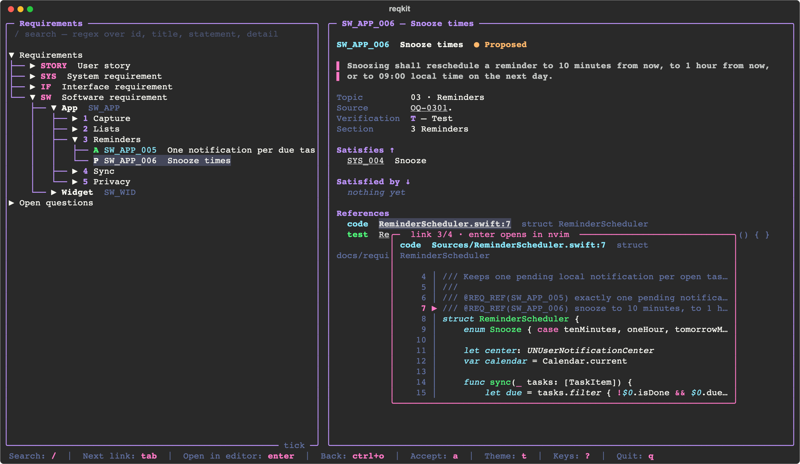
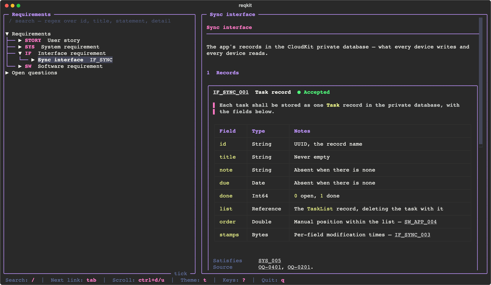

<div align="center">
<h1>reqkit</h1>
Think of <a href="https://www.ibm.com/products/requirements-management">IBM DOORS</a>, but it lives in your git repo, fits in your terminal, and your AI agent can read it.
<br><br>

<a href="https://github.com/danielriege/reqkit/actions/workflows/ci.yml"></a>

<a href="LICENSE"></a>

</div>

## The problem

AI agents write code faster than anyone can review it. Describe roughly what you want and
you get something that runs. That is vibe coding, and for a weekend project it is great.

For anything bigger it breaks in a predictable way. The agent builds what it *guesses* you
meant. Every gap in the description gets filled with a plausible default — a timeout, a
limit, a retry policy, a field nobody asked for — and none of them were decided by anyone.
It works in the demo. Three months later nobody can say what the system is *supposed* to do,
so nobody can say whether it does it, and every change is a coin flip.

Old-school engineering has had an answer to this for decades: the
[V-model](https://en.wikipedia.org/wiki/V-model). Down the left side, you write down what to
build, at increasing levels of detail — user needs, system requirements, the requirements on
each part. Up the right side, you prove each of those levels with a test. Every requirement
has a reason above it and a test beside it.

Agents made the bottom of the V nearly free. Code is cheap now. **The left side** — deciding
what to build — **and the right side** — proving it was built — are what is left, and they
matter more than they ever did. They are also exactly the parts an agent cannot do alone:
the decisions have to come from a person, and the proof has to be checkable by one.

## What reqkit does

reqkit keeps both sides of the V in your repo, next to the code, linked together, in files
an agent reads as easily as you do.

- **Open questions first.** Before anything is a requirement it is a question in
  `OPEN-QUESTIONS.md`. The agent researches it, lays out options, recommends one. **You
  decide.** The answer is written down where the question was.
- **Requirements from answers.** Each requirement names the decision it came from. No
  source, no requirement — an agent cannot slip in a number nobody chose.
- **Traced, both ways.** Each requirement names what it satisfies one level up. Code and tests
  name what they implement with a `@REQ_REF` marker. `req coverage` tells you what is
  untested, unimplemented or unjustified, and `req trace` exits non-zero for a requirement
  that is not implemented and tested — put it in CI.
- **Reviewed by a human.** Every requirement is `Proposed` until *you* accept it, in the TUI.
  The CLI has no way to write `Accepted`, so an agent cannot mark its own homework.
- **Skills for your agent.** Two skills for Claude Code and Codex: one for the CLI, one for
  the method.

It works the same for an embedded product of three boards and two firmwares as for a single
iOS app.

## Try it

The repo has an example project — Tick, a made-up iOS to-do app with its brief, its open
questions, 23 requirements on three levels below its user stories, and a few Swift files
that point at them.

```bash
git clone https://github.com/danielriege/reqkit
cd reqkit/examples/tick
pip install textual
../../tui.py
```

Move with `j` `k`, `tab` through the links of a requirement, `enter` to follow one. Then:

```bash
../../req.py coverage          # what is untested, uncoded, unreviewed
../../req.py get SW_APP_006    # one requirement: its chain up and down, its code and tests
../../req.py questions --open  # what is still undecided
```

## Use it in your project

```bash
git submodule add https://github.com/danielriege/reqkit .reqkit
.reqkit/init.sh
```

`init.sh` asks for the shape of your requirement tree and the parts of your product, then
writes `.reqkit.toml`, one requirement file per part, an `OPEN-QUESTIONS.md`, and links both
skills into `.claude/skills/` and `.agents/skills/`. It asks everything first, refuses to
overwrite anything, and leaves the project untouched if it fails halfway.

Python 3.11 or newer. The CLI needs nothing else. The TUI needs
[Textual](https://textual.textualize.io/). To get `req` and `req-tui` on your venv's path:

```bash
pip install -e ".reqkit[tui]"
```

Then tell your agent to load the `req-method` skill and start with a product brief.

## The method

1. **Brief.** One page: what it is, for whom, what it deliberately is not.
2. **Stories.** Personas and user stories — the root everything traces to.
3. **Topics.** Cut the design into areas: scope, each interface, each part, power, security…
4. **Questions.** For each topic, find what is undecided — with your agent, not by it.
5. **Answers.** One question per session. The agent researches and recommends, you decide,
   the answer is written in place with the date and the reasoning.
6. **Requirements.** When a topic is answered, its requirements get written. Writing them
   finds gaps; each gap becomes a new question, not an invented value.
7. **Build.** Code and tests carry `@REQ_REF` markers. `req coverage` is the progress bar.

The `req-method` skill holds the details: the levels, how a requirement is worded, which
verification method fits, where a marker goes.

## The TUI



`tui.py` shows every unit as a document — sections numbered, each requirement a card with its
status, statement, detail tables and fields — beside the open questions by topic. The tree
always has the cursor; the right pane shows what it highlights.

| | |
|---|---|
| `j` `k` `h` `l` · `gg` `G` | Move through the tree, as in vim |
| `tab` `shift+tab` | The next, previous link in the right pane, previewed beside it |
| `enter` | Follow the link. A code or test reference opens in your editor |
| `ctrl+o` · `]` | Back, forward through the jumps |
| `/` · `n` `N` | Search · next, previous result |
| `ctrl+d` `ctrl+u` | Scroll the right pane |
| `a` | Accept the highlighted requirement |
| `t` | Theme |
| `?` | All keys |

Every requirement and question ID in the right pane is a link, and so is every code and test
reference, shown with what it is attached to — the test function, the type. Hovering one, or
`tab`-ing to it, previews it: the requirement, or the source around the marker. `enter` on a
reference opens it in `[editor]`, or `$VISUAL`/`$EDITOR`; a terminal editor like nvim gets
the terminal until you quit it, as in lazygit.

It draws like lazygit: rounded borders, one hint line that only lists what applies right
now, and no background — your terminal's shows through. The themes are Textual's own
(Dracula, Nord, Gruvbox, Tokyo Night, Catppuccin, Solarized, Monokai, One Dark, Rosé Pine,
Flexoki), each given a full colour suite by a file in [tool/themes/](tool/themes/README.md),
where you can add your own. Your theme and sidebar width are remembered in
`~/.config/reqkit/tui.json`.

## The CLI

```bash
req get TSR_009                    # one requirement, its chain, its code and tests
req search 'beacon|sync'           # regex over id, title, statement, detail
req list --topic 06 --status proposed
req coverage                       # where traceability is missing
req trace TSSR_FWN_004             # implemented and tested? exit 1 if not
req check                          # validate everything, exit 1 on any problem
req questions --open --topic 04
req add TSSR_FWN --title "Channel PWM" --statement "The Node shall …" \
    --satisfies TSR_025 --topic 06 --source "OQ-0608." --verification T
req edit TSR_009 --statement "…" --source "…"
```

Every command takes `--json`. `add` allocates the next ID and can only write `Proposed`;
`edit` turns an `Accepted` requirement `Reopened`, so a changed requirement goes back to you.
Without the venv, run `.reqkit/req.py` — which is also what CI should use.

## The files

```
.reqkit.toml                    levels, verification methods, marker rules, editor
docs/OPEN-QUESTIONS.md          topics and questions — markdown, edited by hand
docs/requirements/
  stories.csv   stories.toml    user stories, one section per persona
  system.csv    system.toml     one unit per prefix
  icd-bus.csv   icd-bus.toml
  icd-bus.details.md            byte layouts, state tables — one `## <ID>` each
```

A unit's **CSV** holds one requirement per row, ordered by ID and only ever appended to. A
row's line is as permanent as its ID, and the diff of a change is exactly the rows it
touched. It is written by `req add` and `req edit`, never by hand; `check` rejects a file
that is not in the exact form the tool writes.

Its **`.toml`** describes the unit — level, prefix, title, whether code implements it — and
its sections:

```toml
level = "SW"
prefix = "SW_APP"
title = "App"
code = true

[[sections]]
key = "reminders"
title = "Reminders"

[[sections]]
key = "reminders.snooze"     # nests under reminders: shown as 1.1
title = "Snooze"
```

A requirement names its section by key. Numbers come from declaration order when the
document is drawn, so inserting a section renumbers the document without touching a single
requirement — the way DOORS does it.

## `.reqkit.toml`

```toml
requirements = "docs/requirements"
questions = "docs/OPEN-QUESTIONS.md"

[[levels]]                    # most abstract first
kind = "STORY"
reviewed = false              # no source, verification or status
traced = false                # never referenced from code
separator = "-"
digits = 2                    # A-01

[[levels]]
kind = "SYS"
satisfies = ["STORY"]         # what it may link to — check enforces it
topic = true                  # names the OPEN-QUESTIONS topic behind it
traced = false

[[levels]]
kind = "SW"
satisfies = ["SYS"]
topic = true

[verification.T]
name = "Test"
definition = "An automated test shows the requirement is met."
automated = true              # untraced until a test names it

[markers]
test_paths = ["Tests"]                    # a path containing one is a test
declaration_extensions = [".h", ".swift"] # outside tests, markers only here
interface_suffixes = ["_interface"]       # never marked

[editor]
command = "nvim +{line} {file}"           # or "code --goto {file}:{line}"
```

Without `[verification]` the methods are A, I, D and T. Without `[markers]` every common
source file is scanned and a marker may sit anywhere.

## Limitations

- **Small teams.** It is built for one person and their agents, or a handful of people. Two
  branches that both add a requirement to the same unit conflict on the last line of its
  CSV — trivially resolved, but resolved by hand.
- **Markers are text.** `@REQ_REF` is found by a regex, not by parsing your language. Whether
  the *right* code carries the marker is a judgement the tool cannot make for you.
- **No web view.** The TUI is the viewer. `req doc <unit> --markdown` renders a unit as
  markdown when you need to hand it to someone without a terminal.
- **macOS and Linux.** Windows is untested, and handing the terminal to an editor certainly
  is.

## Development

```bash
python3 -m unittest discover tests     # the TUI tests skip without textual
```

## License

MIT. See [LICENSE](LICENSE).
